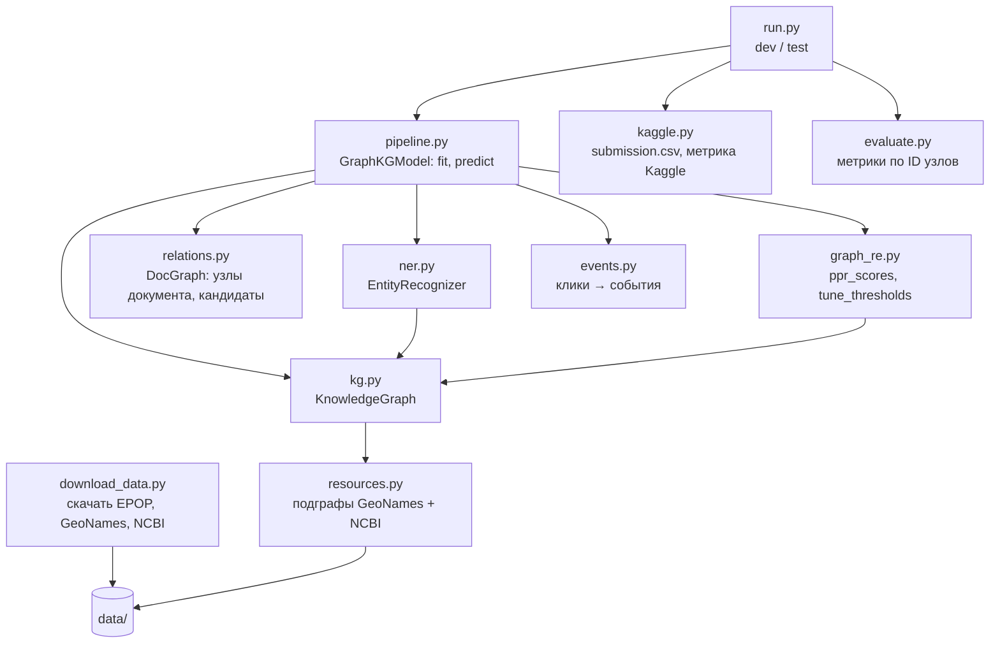

# Карта кода PestCLEF 2026

Весь алгоритм — 1451 строка Python в папке `pestkg/` плюс две точки входа. Чтобы понять решение,
достаточно прочитать пять файлов в порядке ниже. Ссылки ведут на строки кода, где описано
соответствующее место.

## С чего начать

1. [`run.py`](run.py) — точка входа: загрузить данные → обучить → предсказать → записать сабмит.
2. [`pestkg/pipeline.py`](pestkg/pipeline.py) — весь алгоритм на одной странице: `fit` и `predict`.
3. [`pestkg/kg.py`](pestkg/kg.py) — фоновый граф знаний, на который опирается всё остальное.
4. [`pestkg/ner.py`](pestkg/ner.py) — как в тексте находятся сущности и связываются с узлами графа.
5. [`pestkg/graph_re.py`](pestkg/graph_re.py) — как оцениваются отношения (Personalized PageRank).

Остальные файлы вспомогательные: формат данных, ключи узлов, клики, формат Kaggle, метрики.

## Кто кого вызывает



Базовые модули, которыми пользуются все: [`brat.py`](pestkg/brat.py) (документы и разметка) и
[`text.py`](pestkg/text.py) (токены, предложения, ключи узлов).

## Что делает каждый файл

| Файл | Строк | За что отвечает | Главное внутри |
| --- | --- | --- | --- |
| [`run.py`](run.py) | 97 | Точка входа: `python run.py dev` или `test` | [`main`](run.py#L55), [`write_submission`](run.py#L31) |
| [`download_data.py`](download_data.py) | 54 | Скачивает EPOP, GeoNames, NCBI taxdump и строит кэш подграфов | константы URL [L12–19](download_data.py#L12) |
| [`pestkg/pipeline.py`](pestkg/pipeline.py) | 160 | Склеивает шаги; подбор параметров с кросс-фиттингом | [`GraphKGModel.fit`](pestkg/pipeline.py#L79), [`predict`](pestkg/pipeline.py#L121), [`PARAM_GRID`](pestkg/pipeline.py#L28) |
| [`pestkg/kg.py`](pestkg/kg.py) | 190 | Фоновый граф знаний: alias-рёбра, рёбра отношений, иерархия мест | [`KnowledgeGraph.build`](pestkg/kg.py#L48), [`add_document`](pestkg/kg.py#L95), [`link_candidates`](pestkg/kg.py#L130), [`ancestors`](pestkg/kg.py#L143) |
| [`pestkg/resources.py`](pestkg/resources.py) | 159 | Вырезает из GeoNames и NCBI Taxonomy только то, что встречается в корпусе | [`_geonames`](pestkg/resources.py#L50), [`_ncbi`](pestkg/resources.py#L101), [`build_cache`](pestkg/resources.py#L140) |
| [`pestkg/ner.py`](pestkg/ner.py) | 221 | Поиск сущностей по графу + шаблоны дат и болезней | [`Matcher.raw_matches`](pestkg/ner.py#L81), [`EntityRecognizer.__call__`](pestkg/ner.py#L125), [`_resolve_places`](pestkg/ner.py#L147) |
| [`pestkg/relations.py`](pestkg/relations.py) | 65 | Схема отношений и граф сущностей одного документа | [`SIGNATURES`](pestkg/relations.py#L15), [`DocGraph`](pestkg/relations.py#L27), [`candidates`](pestkg/relations.py#L44) |
| [`pestkg/graph_re.py`](pestkg/graph_re.py) | 135 | Оценка отношений случайными блужданиями; пороги | [`doc_matrix`](pestkg/graph_re.py#L48), [`ppr_scores`](pestkg/graph_re.py#L80), [`tune_thresholds`](pestkg/graph_re.py#L113) |
| [`pestkg/events.py`](pestkg/events.py) | 34 | N-арные события = максимальные клики графа отношений | [`cliques_to_events`](pestkg/events.py#L15) |
| [`pestkg/kaggle.py`](pestkg/kaggle.py) | 106 | Формат Kaggle: имена предикатов, метрика, `submission.csv` | [`PREDICATE`](pestkg/kaggle.py#L17), [`kaggle_edges`](pestkg/kaggle.py#L53), [`score`](pestkg/kaggle.py#L66) |
| [`pestkg/evaluate.py`](pestkg/evaluate.py) | 55 | Наши метрики по ID узлов: упоминания, узлы, отношения, события | [`evaluate`](pestkg/evaluate.py#L19) |
| [`pestkg/brat.py`](pestkg/brat.py) | 131 | Чтение/запись разметки EPOP (форматы `.txt/.a1/.a2`) | [`Entity`](pestkg/brat.py#L32), [`Document`](pestkg/brat.py#L49), [`parse_a2`](pestkg/brat.py#L68) |
| [`pestkg/text.py`](pestkg/text.py) | 43 | Токены, границы предложений, ключ узла | [`node_key`](pestkg/text.py#L42), [`sentence_bounds`](pestkg/text.py#L19) |
| [`kaggle_submission.ipynb`](kaggle_submission.ipynb) | — | Ноутбук для Kaggle: клонирует код, запускает `run.py`, кладёт сабмит в `/kaggle/working` | — |

## Что происходит при `python run.py test`

1. [`run.py: load`](run.py#L27) читает тексты и разметку train/dev/test через [`brat.load_split`](pestkg/brat.py#L94).
2. [`GraphKGModel.fit`](pestkg/pipeline.py#L79) на train+dev:
   1. делит документы на 5 фолдов ([L82](pestkg/pipeline.py#L82)); для каждого фолда строит граф знаний **без** этого фолда ([`KnowledgeGraph.build`](pestkg/kg.py#L48)) и находит в нём сущности ([`EntityRecognizer`](pestkg/ner.py#L113));
   2. перебирает 216 комбинаций параметров графа ([L92](pestkg/pipeline.py#L92)), для каждой считает оценки рёбер ([`ppr_scores`](pestkg/graph_re.py#L80)) и пороги ([`tune_thresholds`](pestkg/graph_re.py#L113)), выбирает лучшую по F1;
   3. подбирает порог для клик-событий ([L102](pestkg/pipeline.py#L102));
   4. строит итоговый граф знаний по всем документам ([L117](pestkg/pipeline.py#L117)).
3. [`GraphKGModel.predict`](pestkg/pipeline.py#L121) для каждого тестового документа: сущности → [`DocGraph`](pestkg/relations.py#L27) → оценки рёбер → отбор по порогам и клики ([`decide`](pestkg/pipeline.py#L130)).
4. [`kaggle.kaggle_edges`](pestkg/kaggle.py#L53) переводит рёбра в строки Kaggle (имена предикатов, разворот `Transmits`, одна форма на узел), [`kaggle.write_submission`](pestkg/kaggle.py#L98) пишет `outputs/test/submission.csv`.

`python run.py dev` делает то же на train → dev и печатает метрики ([`evaluate`](pestkg/evaluate.py#L19), [`kaggle.score`](pestkg/kaggle.py#L66)).

## Где что искать

| Вопрос | Куда смотреть |
| --- | --- |
| Что такое «узел» графа? | [`text.node_key`](pestkg/text.py#L42): ID онтологии (`NCBI:…`, `GEO:…`) или тип + нормализованный текст для дат и болезней |
| Откуда берётся фоновый граф? | [`KnowledgeGraph.build`](pestkg/kg.py#L48) → [`add_external`](pestkg/kg.py#L67) (GeoNames, NCBI) + [`add_document`](pestkg/kg.py#L95) (разметка train) |
| Как в тексте находятся сущности? | [`Matcher.raw_matches`](pestkg/ner.py#L81) — самое длинное совпадение с alias-рёбрами; [`EntityRecognizer.__call__`](pestkg/ner.py#L125) — фильтр по доле разметки ([`mention_prior`](pestkg/kg.py#L139)) |
| Как место выбирается по иерархии (Limeira → São Paulo → Brazil)? | [`_resolve_places`](pestkg/ner.py#L147) + [`KnowledgeGraph.ancestors`](pestkg/kg.py#L143) |
| Где шаблоны дат и болезней? | [`DATE_RE`](pestkg/ner.py#L16), [`DISEASE_RE`](pestkg/ner.py#L32), [`_dates`](pestkg/ner.py#L165), [`_diseases`](pestkg/ner.py#L174) |
| Как строится граф документа? | [`graph_re.doc_matrix`](pestkg/graph_re.py#L48): сущность—предложение, предложение—следующее, рёбра фонового графа ([L74](pestkg/graph_re.py#L74)) |
| Где формула оценки ребра? | [`ppr_scores`](pestkg/graph_re.py#L80): обращение матрицы [L90](pestkg/graph_re.py#L90), априор из графа [L107](pestkg/graph_re.py#L107), центральность [L109](pestkg/graph_re.py#L109); формула целиком — в начале файла |
| Какие пары типов допустимы для отношения? | [`relations.SIGNATURES`](pestkg/relations.py#L15) |
| Как подбираются параметры и пороги? | [`PARAM_GRID`](pestkg/pipeline.py#L28), [`fit`](pestkg/pipeline.py#L79), [`tune_thresholds`](pestkg/graph_re.py#L113) |
| Почему нет утечки при подборе? | Кросс-фиттинг в [`fit`](pestkg/pipeline.py#L82): граф для документа строится без его фолда |
| Как получаются события? | [`events.cliques_to_events`](pestkg/events.py#L15) + правило «общее предложение» [`pipeline.event_edges`](pestkg/pipeline.py#L46) |
| Как переводится в формат Kaggle? | [`kaggle.PREDICATE`](pestkg/kaggle.py#L17), [`REVERSED`](pestkg/kaggle.py#L26) (`Transmits` — обратное направление), [`node_form`](pestkg/kaggle.py#L44) (какую строку печатать для узла) |
| Как считается метрика Kaggle? | [`kaggle.score`](pestkg/kaggle.py#L66): ребро засчитано, если предикат совпал и обе строки есть среди допустимых форм |
| Как читается разметка EPOP? | [`brat.parse_a2`](pestkg/brat.py#L68) |
| Откуда скачиваются данные? | [`download_data.py`](download_data.py#L12), фильтр внешних графов по корпусу — [`resources.corpus_ngrams`](pestkg/resources.py#L40) |

## Части рассказа → файлы

| Часть документа | Что рассказывает | Файлы |
| --- | --- | --- |
| 1. Задача, общая схема и поиск сущностей | граф знаний, alias-рёбра, GeoNames/NCBI, иерархия мест | `kg.py`, `resources.py`, `ner.py`, `text.py` |
| 2. Отношения, события и формат Kaggle | граф документа, PageRank, клики, `submission.csv` | `relations.py`, `graph_re.py`, `events.py`, `kaggle.py` |
| 3. Результаты и как мы к ним пришли | подбор параметров, метрики, запуск | `pipeline.py`, `evaluate.py`, `run.py`, `kaggle_submission.ipynb` |

## Папки с данными и результатами

Обе папки не хранятся в git и создаются при запуске.

```
data/
  EPOP_documents/{train,dev,test}/*.txt     тексты статей
  EPOP_annotations/{train,dev}/*.a1, *.a2   разметка
  ext/                                      GeoNames, NCBI taxdump, external_kg.json (кэш подграфов)
  kaggle/PestCLEF-2026_{dev,test}.json      JSON соревнования (необязательно: метрика Kaggle, список doc_id)
outputs/{dev,test}/
  submission.csv                            сабмит Kaggle: doc_id, knowledge_graph
  relations.csv, events.csv                 те же рёбра и n-арные события в виде таблиц
  a2/*.a2                                   предсказания в формате разметки EPOP
  kg/kg_triples.tsv, kg/kg_nodes.json       фоновый граф знаний
```

## Словарь

| Термин | Что значит в коде |
| --- | --- |
| узел | одна реальная сущность: таксон, место, дата, болезнь ([`node_key`](pestkg/text.py#L42)) |
| alias-ребро | «написание → узел», например `X. fastidiosa → NCBI:2371` ([`kg.alias`](pestkg/kg.py#L35)) |
| фоновый граф | граф знаний из разметки train + GeoNames + NCBI ([`KnowledgeGraph`](pestkg/kg.py#L33)) |
| граф документа | сущности и предложения одной статьи ([`doc_matrix`](pestkg/graph_re.py#L48)) |
| PPR | Personalized PageRank: насколько узел t близок к h при случайном блуждании из h |
| кросс-фиттинг | признаки для документа train считаются по графу, собранному без этого документа |
| клика | набор узлов, где каждая пара связана ребром; так получаются события |
